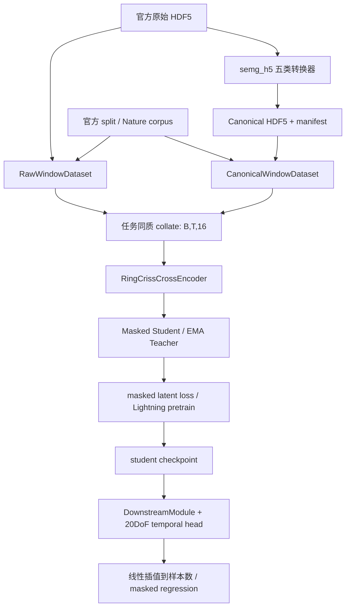

# 正式模型架构与当前数据流

metafmodel 是唯一正式工程。MetaEMGFM 保存原始数据、历史验证和共享 Python 环境。
模型没有替换：原有时域 Conv patch + 频域 FFT patch、Temporal Attention、
Ring Attention、门控融合、残差 FFN 和环池化均保留。

对应代码：`semg_fm/data/raw_adapter.py`、`intervals.py`、`window_dataset.py`、
`datamodule.py` → `semg_fm/models/patch_encoder.py`、`ring_criss_cross.py`、
`ring_attention.py` → `semg_fm/lightning/pretrain_module.py` →
`semg_fm/lightning/downstream_module.py`、`models/heads.py`。

Encoder 输入 `[B,T,16]`，输出 `z_eq=[B,16,T/patch,D]`、
`z_motion=[B,T/patch,D]`。Pose head 输出 `[B,T/patch,20]`，原生线性插值到
`[B,T,20]`；label 和 no_ik_failure 按相同 sample slice 对齐。

Ring cyclic permutation 测试只能验证数学对称性。没有核验真实左右手电极编号、
反向环排列及佩戴旋转，因此不构成真实旋转鲁棒性证据。
ring equivariance error 是无梯度诊断，未纳入实际优化目标；有效 loss 是
`latent_weight * latent + kinematic_weight * kinematic`。
