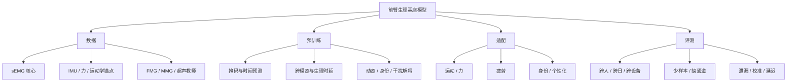

# 研究地图与入门指南

## 1. 先建立正确问题

这项研究不是“训练一个更大的手势分类器”，而是学习可复用的前臂神经肌肉表示。一个窗口同时包含：当前动作与力、疲劳等慢变状态、个体解剖和招募习惯、设备/电极位置与会话噪声。不同下游任务需要的因素不同，甚至彼此冲突。因此主问题是：如何利用多源无标签数据学习共享结构，同时把任务因素与干扰因素分开。

## 2. 概念地图

## 3. 入门知识清单

### 生理与信号

需要理解运动单位、肌肉招募、肌纤维传导、串扰、电—机械延迟、等长/等张收缩和疲劳/恢复。信号层面掌握采样、抗混叠、带通/陷波、整流包络、时频分析、SNR 和电极接触。特别注意：归一化会改变幅值意义，滤波会影响延迟，窗口重叠会造成泄漏。

### 机器学习

需要掌握 1D CNN/TCN、Transformer、masked autoencoder、对比学习、多任务学习、域泛化、知识蒸馏和度量学习。理解 frozen probe、few-shot、全量微调分别测什么；理解互信息/对抗解耦只能提供操作性分离，不能自动给出因果解释。

### 实验方法

参与者是独立统计单位；同一 trial 的重叠窗口不是独立样本。随机切窗口通常会虚高成绩。疲劳、身份和动作标签应尽量正交，设备与数据集不能完全共线。预先写主要终点、排除规则和切分清单。

## 4. 建议阅读顺序

1. 先读 BENDR、BIOT、LaBraM 和 CBraMod，理解原始波形、自监督、可变通道与时空建模。
2. 再读 Apple wearable FM、PaPaGei 和 MOMENT，理解大规模纵向数据、领域先验和通用时序基线。
3. 阅读 Nature 2025 通用神经运动接口、AEMG、emg2pose 和 Hyser，建立当前 EMG 规模与任务边界。
4. 最后读本包方案与评测，尝试用一页纸复述每个设计选择对应的失败模式。

核心链接和状态均在 [文献矩阵](literature_matrix.csv) 中；正式写作时从 [BibTeX](references.bib) 导入，并再次核对目标期刊格式。

## 5. 第一个可运行实验

用 NinaPro 或 Hyser 做参与者级切分，建立四个基线：手工特征+LDA、TCN、从头 Transformer、掩码预训练 Transformer。固定编码器后训练手势线性探针，再以每类 1/5/10 个样本微调。随后加入通道丢失和一次真实/模拟电极偏移。

这个实验的目的不是发论文，而是验证数据管线：若随机切窗与跨人切分差距很小，应检查切分是否真正按人隔离；若预训练只在 100% 标签时有效，说明表示的数据效率优势尚未建立。

## 6. 从复现到研究问题

完成第一个实验后，按以下顺序增加难度：

- 多数据集预训练，完整留出一个外部数据集。
- 加入 IMU/力，比较简单拼接与跨模态未来预测。
- 加入多日数据，把身份、会话和动态状态分支化。
- 加入疲劳与恢复协议，建立时间戳捷径基线。
- 在小子集加入 HD-sEMG/超声教师并蒸馏到低密度设备。
- 最后比较连续表示与离散收缩 tokenizer。

## 7. 判断一篇论文是否值得借鉴

快速检查六项：预训练人数和小时数；是否跨人/跨日/跨设备；测试人是否进入过无标签预训练；是否与从头同架构及通用时序模型比较；是否有冻结、少样本和全量微调；代码、权重、数据和许可是否可得。缺少这些信息时，漂亮的单一准确率不能证明基座能力。

## 8. 本项目的最小研究主张

最稳健的首篇主张应是：多源、多尺度、因素可分解的前臂 sEMG 预训练，在严格跨被试/跨会话评测中提高运动、疲劳和身份任务的数据效率，并能定量控制身份和设备信息在不同潜变量间的泄漏。任何更强主张，如“通用肌肉语言”或“跨设备零样本”，都应在专门证据出现后再提出。
