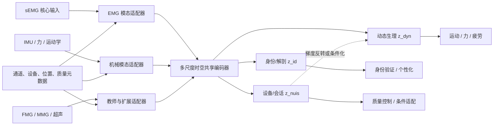

# 前臂生理基座模型方案

## 1. 目标与边界

目标是预训练一个“肌肉中心”的前臂生理编码器，使运动解码、疲劳估计、身份验证等成为平级下游任务。sEMG 是核心部署输入；IMU、力/运动学是第一阶段生理锚点；FMG/MMG 是后续互补模态；超声/EIT 是高成本教师。首版不追求十亿参数，而追求可迁移、可缺模态、可审计和可复现。

明确不做三件事：不把随机窗口准确率当跨人泛化；不把所有模态简单早期拼接；不因模型大或预训练数据多就直接称“基座”。

## 2. 核心假设

H1：多数据集无标签预训练能提高跨被试、跨日和少样本下游性能。

H2：EMG 与机械输出之间的跨模态预测，比纯波形重建更能学习与肌肉功能相关的表示。

H3：把动态状态、身份/解剖和设备/会话分解到不同潜变量，可以同时改善跨人运动解码和跨会话身份验证，并降低错误泄漏。

H4：高密度 EMG 或超声教师可提升低密度 sEMG 学生，且部署不需要教师模态。

每个假设都有对应消融和否证条件，见 `06_评测基准与实验矩阵.md`。

## 3. 总体数据流

## 4. 输入表示

### 4.1 波形路径

sEMG 保留两个同步视图：物理幅值视图和 robust 标准化形态视图。模态适配器使用轻量 1D 卷积/可分离卷积提取 20–50 ms 局部 patch；每个 token 附带采样率、通道位置、设备、左右侧、质量标记和增益信息。

IMU 以加速度/角速度分别编码；力与关节角作为连续机械状态；高密度阵列保留二维坐标。不同采样率先在各自适配器中处理，不在原始层强制同步到一个巨大共同频率。

### 4.2 多尺度层级

- 微观层 20–50 ms：局部波形、传播和运动单位相关模式。
- 收缩层 200–500 ms：动作、力和肌肉协同。
- 状态层 5–30 s：疲劳、恢复、信号质量变化。
- 会话层 1–10 min：身份、日间漂移和佩戴条件摘要。

共享编码器可采用局部注意力/TCN 加少量全局 token；不要把几分钟原始 token 全部放进平方复杂度注意力。

## 5. 三分支潜变量

### 5.1 动态生理分支 `z_dyn`

保留动作、力、瞬态收缩和疲劳状态。运动/力任务主要读取短—中尺度 token；疲劳读取长尺度聚合。该分支应对身份和设备尽量不敏感，但不能用过强对抗损失删除与生理相关的个体差异。

### 5.2 身份/解剖分支 `z_id`

保留跨会话相对稳定的个体模式，用于授权身份验证和个性化条件。训练正样本是同一人不同天/重新佩戴片段，且尽可能匹配动作和强度，避免身份头只识别行为习惯。

### 5.3 设备/会话分支 `z_nuis`

显式预测数据集、设备、会话、采样率档和质量状态。其作用不是服务主要下游，而是把不可避免的域信息隔离出来，并可作为条件归一化参数。动态分支通过梯度反转、互信息上界或正交约束减少这些信息。

完全独立通常不现实。目标是“任务充分、交叉泄漏可控”，用探针定量，而不是声称获得严格因果解耦。

## 6. 预训练任务

总损失建议写为：

\[
\mathcal{L}=\lambda_m\mathcal{L}_{mask}+\lambda_x\mathcal{L}_{cross}+\lambda_t\mathcal{L}_{temporal}+\lambda_i\mathcal{L}_{identity}+\lambda_n\mathcal{L}_{nuisance}+\lambda_d\mathcal{L}_{disentangle}+\lambda_q\mathcal{L}_{quality}.
\]

### 6.1 多粒度掩码建模 `L_mask`

随机遮挡连续时间块、完整通道、局部阵列区域和整个模态。预测潜变量与多分辨率 log-spectrum，而不是只最小化逐点 MSE。遮挡策略按动作/静息、强度、数据集和质量分层，避免大量静息片段支配训练。

### 6.2 跨模态预测 `L_cross`

从 EMG 预测未来多个 horizon 的力/运动潜变量；从多模态上下文重建缺失模态；同步模态对比只在允许的时延窗口内定义正样本。增加“EMG-only 必须可解码”的约束，防止 IMU 捷径。

### 6.3 时间结构 `L_temporal`

判断片段顺序、预测未来潜变量或进行多尺度 CPC。疲劳数据中可加入单调性弱约束，但恢复段和非单调协议必须允许反转，不能硬编码“时间越晚越疲劳”。

### 6.4 身份一致性 `L_identity`

仅作用于 `z_id`。同一人跨日、不同任务形成正样本；不同人形成负样本或采用分类代理。动作分布需匹配，且身份任务使用独立验证协议。

### 6.5 干扰建模与解耦 `L_nuisance/L_disentangle`

`z_nuis` 主动预测设备/会话；`z_dyn` 对设备/身份做梯度反转或条件 HSIC/协方差惩罚；`z_id` 对动作标签做弱对抗。损失权重从小到大 warm-up，因为早期强对抗容易删除全部有用信号。

### 6.6 质量任务 `L_quality`

预测通道脱落、饱和、伪迹和合成电极偏移强度；同时输出窗口质量分数和不确定性。质量任务使模型知道“不知道”，而非对损坏输入给出高置信预测。

## 7. 训练课程

### 阶段 A：单模态稳定预训练

用所有 sEMG 训练适配器、共享编码器和 `z_dyn/z_nuis`，目标为多尺度掩码、通道恢复和质量识别。参数建议 10M–30M，先确保训练稳定和跨库收益。

### 阶段 B：多模态生理对齐

加入 emg2pose、Hyser、HD-FW KIN 等同步运动学/力数据；训练跨模态预测和缺模态重建。保持 30%–60% batch 为 sEMG-only，随机丢弃伴随模态。

### 阶段 C：因素解耦

用多日/多会话数据训练身份和干扰分支。先训练各头可读，再逐步加对抗/正交约束。每轮记录交叉探针，防止为了降低身份泄漏而损害所有任务。

### 阶段 D：教师蒸馏与离散化探索

在高密度 EMG、FMG/MMG 或超声子集上训练教师；向低密度 sEMG 蒸馏共享动态表示。连续模型验证成功后，再训练神经肌肉 tokenizer，比对连续、离散和混合表示。

## 8. 下游接口

- 手势分类：窗口级 `z_dyn` + 轻量 MLP。
- 连续姿态/力：因果 token + TCN/Transformer decoder，报告延迟。
- 疲劳：长时 `z_dyn` 聚合 + 序数/回归头，同时输入任务强度条件。
- 身份验证：`z_id` 度量学习头，注册模板取多会话均值和不确定性。
- 个性化：用 `z_id` 作为条件，或训练 LoRA/adapter；不得把测试标签用于选择校准窗口。
- 信号质量：`z_nuis`/质量 token 直接输出，服务拒识和重采建议。

## 9. 三条研发路线

### 路线 1：通用时间序列基线

最快，直接使用 MOMENT 类模型或同规模 MAE。价值是判断问题是否需要专属架构；不作为最终创新主体。

### 路线 2：肌肉中心因子化多模态模型（主线）

模态适配器、共享多尺度编码器和三分支潜变量。科学问题清晰，能同时解释运动、疲劳和身份；工程复杂度可控。

### 路线 3：神经肌肉离散语言

学习跨设备收缩 code，并研究 code 序列生成/预测。潜在可扩展性高，但 tokenizer 质量和跨任务信息损失风险较大，作为主线成熟后的论文方向。

## 10. 最小可行模型（MVP）

MVP 采用 8–16 通道 sEMG + 可选 IMU，约 20M 参数；2 kHz/1 kHz 双采样率档；局部卷积 tokenizer + 8–12 层因子化 Transformer；`z_dyn/z_id/z_nuis` 各 128–256 维。先在 emg2pose、NinaPro、Hyser 和多日数据上预训练，验证手势、姿态/力、疲劳、身份四类任务。

MVP 成功门槛：至少三个任务在严格跨人/跨日或少样本设置下稳定优于从头训练；对电极偏移和缺通道有可量化收益；身份分支跨会话有效；动态分支的身份探针显著低于未解耦模型，同时主要任务下降不超过预设容忍值。

## 11. 风险与止损点

| 风险 | 早期指标 | 应对/止损 |
|---|---|---|
| 通用模型已足够 | 专属模型不优于MOMENT | 转向数据/评测贡献，简化架构 |
| 多模态只学IMU | 去掉IMU后EMG性能无改善 | 增加modality dropout和EMG-only蒸馏 |
| 解耦损害任务 | 主任务下降且泄漏仅小幅降低 | 降低对抗权重，改为条件化/后处理 |
| 疲劳标签不可重复 | 跨日一致性低于基线 | 收紧协议，引入力和恢复标签 |
| 身份结果是会话捷径 | 跨会话EER显著恶化 | 多日重佩戴、动作匹配、设备平衡 |
| 数据许可阻碍发布 | 权重再分发不明确 | 分开开放/受限训练线，发布可审计子模型 |

## 12. 预期论文贡献层次

第一篇可聚焦统一基准与因子化预训练：证明多任务、跨日和少样本收益。第二篇聚焦多模态教师—学生和生理时延约束。第三篇再研究离散神经肌肉语言及更大规模语料。这样每一步都有独立可证伪问题，不需要等“超级大模型”训练完成才产出结果。
